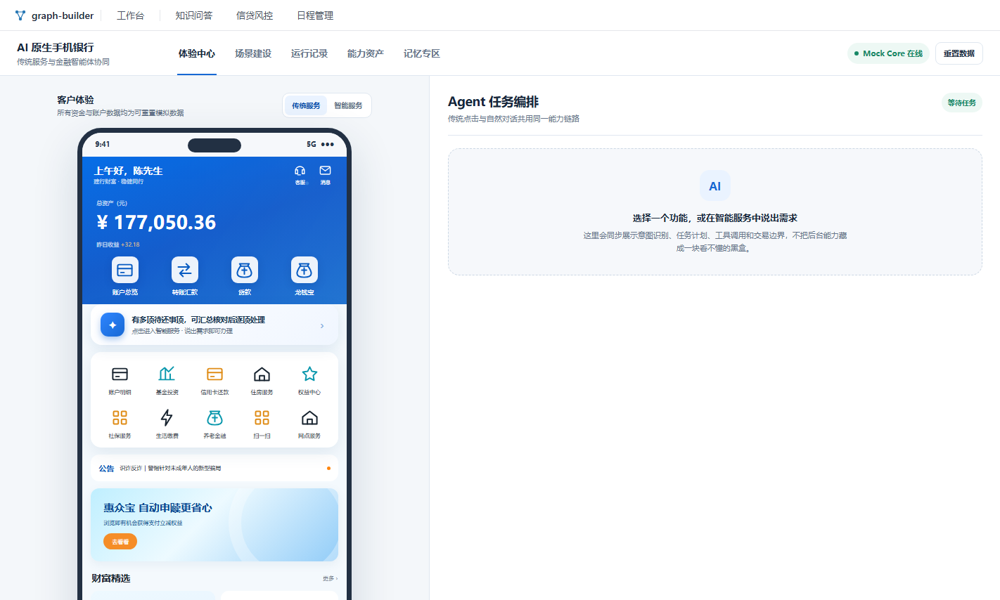
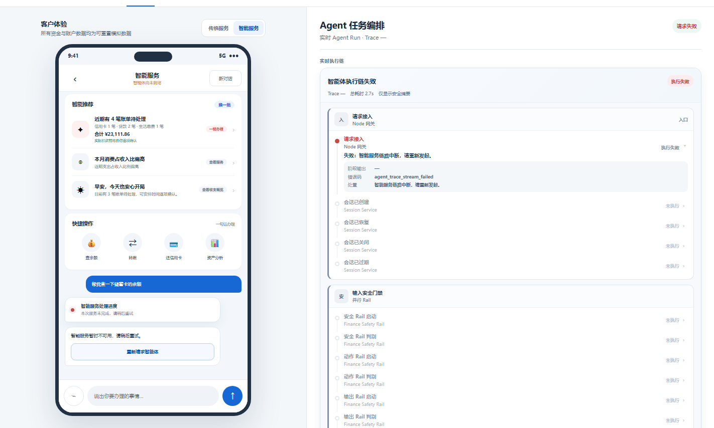
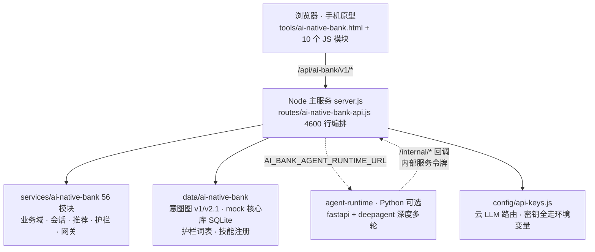

<p align="center">

</p>

# ai-native-bank

AI 原生手机银行原型：用户一句话，Agent 完成意图识别 → 任务编排 → 业务执行 → 下一步行动推荐。Node 主服务 + 可选 Python agent-runtime，clone 即跑。

> [!NOTE]
> 这是交互范式验证原型，**不是真实银行系统**——全部客户与账户数据为本地合成的 mock（测试号段手机号、虚构账户），无任何真实个人信息。

## 是什么

把「翻菜单找功能」的手机银行，换成「直接说事」的 Agent 对话：你说「给妈妈转 500」，系统识别意图、追问缺失要素（哪张卡、确认收款人）、执行转账、然后主动建议下一步（如「本月已给妈妈转了 3 次，要设定期转账吗」）。

三条设计主线：

- **意图图引擎**：意图识别走规则化的意图图（v2.1 图 + 语义索引 + 别名包），不依赖训练模型即可跑通主链路——银行场景要求可解释、可审计，每个意图的追问话术与槽位 schema 都在图里
- **Agent 会话编排**：多轮对话、可恢复工作流、确认卡（转账这类敏感动作强制用户确认后执行）、会话空闲过期
- **不藏黑盒**：前端同步展示意图识别结果、任务计划、工具调用链——每个动作可追溯

<p align="center">

</p>

## 特性

- **10 个业务域 mock 服务**：转账 / 理财 / 信用卡 / 贷款 / 生活缴费 / 现金流 / 待办履约 / 推荐 / 财富洞察 / 账户
- **意图图 v1→v4**：节点带槽位 schema、追问话术、技能绑定；语义索引 + 别名包做召回，schema 校验用 ajv
- **agent-runtime（可选 Python）**：fastapi + openjiuwen deepagent，深度多轮意图与业务编排；不启动则对话降级为图引擎
- **自引用模型网关**：runtime 容器经 Node 主服务的 `/internal/model/v1/*` 端点转发云 LLM（内部服务令牌鉴权），密钥不进容器
- **Guardrail Lab**：第三方 finance-guardrail 的隔离验证环境（离线容器、network_mode: none、资源受限），输入护栏词表本地分发
- **Next Action 引擎**：信号源（账户状态/行为）→ 排序 → 主动推荐，驱动「下一步行动」卡片
- **记忆专区**：Agent 会话记忆的查看与管理（memory-command-worker 异步落库）
- **静态服务白名单**：只有 `tools/` 可经 HTTP 读取，data/（用户 mock 数据）与源码一律 403

## 快速开始

```bash
git clone https://github.com/wanshoulu/ai-native-bank.git
cd ai-native-bank
npm install && npm start     # → http://127.0.0.1:3012
```

浏览器打开即是手机原型（mock 客户「陈先生」）。点首页的 ✦「进入智能服务」体验对话链路。默认端口 `3012` 而非 `3000`：本机 `3000` 通常是 AI Harbor 主站的端口，独立部署用不同端口可避免 `EADDRINUSE`；需改端口时设置 `PORT`。

**完整对话智能（可选，起 Python 运行时）：**

```bash
cd services/ai-native-bank/agent-runtime
pip install -r requirements.txt
python -m uvicorn app.main:app --host 127.0.0.1 --port 18120
# 回仓库根目录：
AI_BANK_AGENT_RUNTIME_URL=http://127.0.0.1:18120 npm start
```

Docker 方式（runtime 容器化，镜像内自带意图图数据）：

```bash
docker build -t ai-native-bank-agent-runtime -f services/ai-native-bank/agent-runtime/Dockerfile .
```

## 架构



实线为主链路；虚线为可选 Python 运行时（不启动时对话走图引擎降级）。

## 对话链路（HTTP 视角）

```bash
# 1. 创建会话（30 分钟空闲过期）
curl -X POST http://127.0.0.1:3012/api/ai-bank/v1/agent-sessions -d '{}'
# → 201 {"data":{"id":"conv_xxx","status":"active",...}}

# 2. 发一句话（意图识别 → 编排 → 执行 → 回复）
curl -X POST http://127.0.0.1:3012/api/ai-bank/v1/agent-runs \
  -d '{"conversationId":"conv_xxx","message":"帮我查一下余额"}'
# → 回复含意图结果、执行状态与下一步建议
```

敏感动作（转账确认）会先返回确认卡，用户确认后才真正执行——API 层面体现为 `agent-sessions/recommendation` 与工作流恢复锚点。

## 名词表

| 名词 | 含义 |
|---|---|
| 意图图（intent graph） | 意图的结构化描述（节点 = 意图，含槽位 schema、追问话术、技能绑定），当前版 v2.1 + 语义索引 |
| Agent Session | 一次对话会话，绑定客户身份与焦点，30 分钟空闲过期 |
| Agent Run | 一次用户消息触发的智能处理（意图识别 → 编排 → 执行 → 回复） |
| Next Action | 主动推荐（还款提醒、理财建议等），信号引擎 + 排序引擎产出 |
| agent-runtime | Python 侧运行时（deepagent 业务编排），经环境变量被主服务发现 |
| guardrail | 输入护栏（违禁词 / 注入检测），词表在 `data/guardrail/lexicon/` |
| capability | 智能体能力注册：哪个意图可以由哪个技能执行 |
| 确认卡 | 敏感操作（转账/购买）的用户确认 UI，确认前不执行 |

## 目录

```
server.js                     入口（根路径 302 → 工具页，静态 tools/ 白名单）
routes/ai-native-bank-api.js  /api/ai-bank/v1 全量 API（会话/意图/执行/推荐/内部网关）
routes/intent-evaluator-*.js  意图评测路由（多轮 / 歧义 / 图统计）
services/ai-native-bank/      业务服务层 56 模块
services/.../agent-runtime/   Python 运行时（fastapi，可选）
services/.../guardrail-lab/   护栏隔离实验室（独立 docker compose，可选）
tools/                        前端原型（单页 + 10 个 JS 模块，零构建）
data/ai-native-bank/          意图图 / mock 核心库 / 护栏词表 / 技能注册
```

## 测试

```bash
npm test                                                  # Node 侧：意图多轮 / 歧义 2 套
cd services/ai-native-bank/agent-runtime && python -m pytest tests/   # Python 侧
```

## 安全说明

- 密钥一律环境变量（`.env.example` 模板；`.env` 不入库）
- 静态服务 `tools/` 白名单：`.env`、`data/`（用户 mock 数据）、源码全部 403
- 内部端点（`/internal/*`）需要内部服务令牌（`AI_BANK_AGENT_RUNTIME_TOKEN`）
- 全部客户数据为合成 mock（测试号段手机号），无真实个人信息

## 已知限制

- 免登录设计（单客户演示身份），无真实鉴权体系
- 对话智能的深度多轮依赖 Python runtime；不启动时意图识别走图引擎，复杂上下文会降级
- 业务执行全部为 mock（写本地 SQLite），不对接任何真实银行通道
- 性能未调优：56 个服务模块在单进程内同步初始化，启动约 2-3 秒

## License

MIT（agent-runtime 依赖 openjiuwen；guardrail-lab 上游为 Apache-2.0 隔离副本，见其 README）
